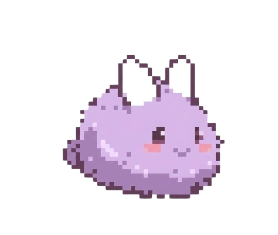

# Stream Sprites

**Version 1.0.2** | Copyright 2026 SuperFurias | Apache License 2.0

Stream Sprites is an interactive overlay application that brings your Twitch chat to life with animated sprites. Each viewer gets their own sprite that appears on your overlay, creating a dynamic and engaging experience.



---

## Quick Start

### Windows (Recommended)

```powershell
.\start.ps1
```

### Manual Setup

1. Ensure Node.js 18+ is installed
2. Install dependencies: `cd server && npm install`
3. Start the server: `npm start`
4. Open `http://localhost:8080` in your browser

---

## Configuration

After starting the server, open the dashboard at `http://localhost:8080` to configure the application.

Configuration is saved to `server/.env`.

---

## Overlay

Add the overlay to OBS as a Browser Source with URL: `http://localhost:8080/overlay/overlay.html`

---

## Documentation

For complete documentation, troubleshooting, and detailed feature descriptions, see the **Help** tab in the dashboard after starting the server.

For version history and release notes, see [CHANGELOG.md](CHANGELOG.md).

---

## License

Apache License 2.0 - see [LICENSE](LICENSE) and [NOTICE](NOTICE) files for details.
