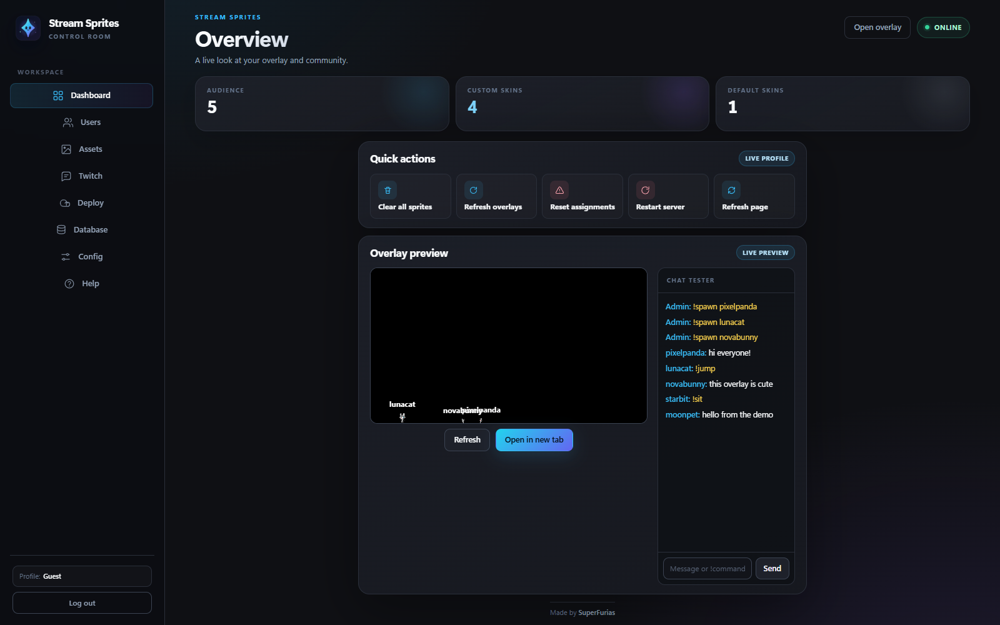
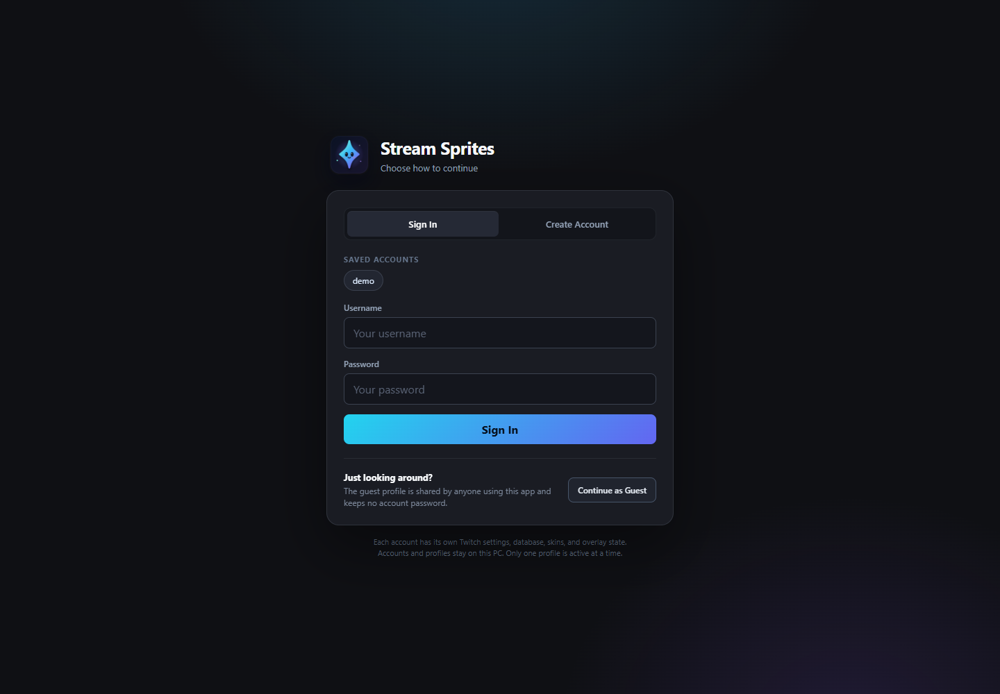
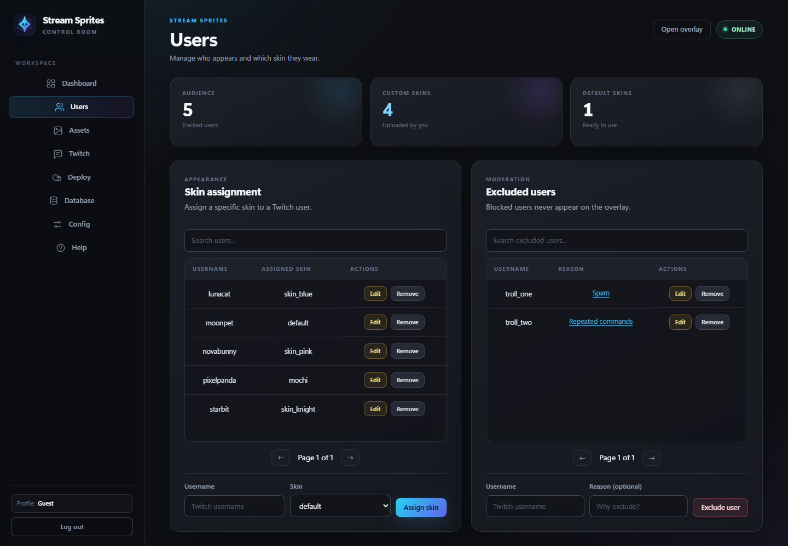
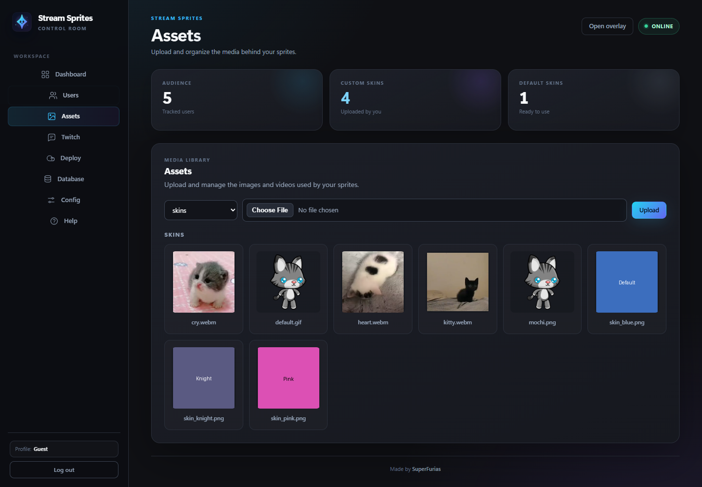

# Stream Sprites

Copyright 2026 SuperFurias | [Apache License 2.0](LICENSE)

[](LICENSE)
[](https://github.com/SuperFurias/stream-sprites/actions/workflows/ci.yml)

Stream Sprites is a powerful, feature-rich Twitch overlay application that transforms chat participation into an interactive visual experience. Each viewer receives a personalized sprite with realistic physics, creating a living, breathing community representation on your stream.

<p align="center">
  <a href="docs/screenshots/dashboard.png"></a>
</p>

<p align="center">
  <a href="docs/screenshots/account-chooser.png"></a>
  <a href="docs/screenshots/users.png"></a>
  <a href="docs/screenshots/assets.png"></a>
</p>

<p align="center"><sub>Dashboard · Account chooser · User management · Asset library — screenshots use demo data.</sub></p>

---

## ✨ Features

### Core Functionality
- **Real-time Twitch Integration** – Live chat-to-sprite conversion with WebSocket communication
- **Server-Authoritative State** – Centralized sprite management prevents duplicates and ensures consistency
- **Advanced Physics Engine** – Gravity, collisions, friction, bouncing, and spatial awareness
- **Dynamic Skin System** – Automatic detection from `app/assets/skins/` with support for PNG, JPG, GIF, WebP, and WebM
- **User Skin Assignments** – Persistent per-user skin preferences stored in SQLite or PostgreSQL
- **Local Accounts & Profiles** – Shared guest profile plus separate accounts with isolated Twitch settings, databases, skins, and overlay state
- **Admin Dashboard** – Full-featured web interface for configuration and management

### Interactive Commands
Users can control their sprites via Twitch chat:
- `!jump` – Make your sprite jump
- `!sit` / `!unsit` – Sit down or stand up (height scaling)
- `!boom` – Trigger an explosion affecting all sprites
- `!skin <skinId>` – Change your assigned skin
- `!skins` – List all available skins
- `!spawn [quantity] [skin] [username]` – Broadcaster/mod spawn (additive)

### Physics & Behavior
- **Collision System** – Probabilistic collisions with spatial hash optimization
- **Size-Based Social Dynamics** – Similar-sized sprites repel; different sizes attract
- **Zone Distribution** – Automatic balancing to prevent overcrowding
- **Roaming Behavior** – Idle sprites explore underpopulated areas
- **Drag-and-Drop** – Direct manipulation of sprites in the overlay
- **Explosion Particles** – Visual feedback with configurable particle physics

### Configuration & Customization
- **70+ Tunable Parameters** – Fine-tune physics, visuals, spawning, and behavior
- **Dynamic Updates** – Changes apply without server restart
- **Debug Logging** – Console and file-based logging with granular control
- **OAuth Management** – Automatic token generation with refresh token persistence
- **User Exclusion System** – Ban users with custom reason tracking
- **Skin Assignment Manager** – Bulk user skin management with pagination

---

## 🚀 Quick Start

### Windows Desktop App

Download the latest Windows release from the [Releases page](https://github.com/SuperFurias/stream-sprites/releases/latest), or run **`Stream Sprites.exe`** from the repository root. The native window opens immediately with a loading screen, then shows the account chooser. Continue as **Guest**, sign in to an existing account, or create a new one. After a profile is selected, the local server starts and the dashboard opens with standard Windows minimize, maximize, and close controls. The window remembers its last size, position, and maximized state. Closing the window stops the server and exits the app.

Each account gets its own Twitch configuration, database, skins, logs, and overlay state. Only one profile is active at a time; **Log out** from the dashboard returns to the account chooser. The guest profile is shared by anyone using the app and is the existing single-profile data after upgrading.

The launcher is a ~1.5 MB Windows executable that uses the installed Edge WebView2 runtime and Node.js. The `app/` folder must stay next to the executable. Account data, profiles, configuration, logs, and WebView2 cache stay in `%APPDATA%\Stream Sprites`.

The executable includes the Stream Sprites product, company, copyright, trademark, and Apache-2.0 license metadata. Builds are currently unsigned, so Windows UAC may still show **Unknown publisher**; removing that requires a trusted code-signing certificate.

### Prerequisites
- **Node.js 22+** – [Download from nodejs.org](https://nodejs.org/)
- **Microsoft Edge WebView2 Runtime** – Included with current Edge and Windows 11
- **.NET 8 Desktop Runtime** – Required by the native desktop launcher
- **Twitch Account** – For bot credentials and OAuth
- **.NET 8 SDK** – Only needed to build the desktop executable

### Source Installation (Windows – Recommended)

1. **Clone or download** this repository to your local machine

2. **Run the startup script** from the app folder (PowerShell):
   ```powershell
   cd app
   .\start.ps1
   ```

   The script will:
   - Check for Node.js and offer to install if missing (via winget or Chocolatey)
   - Install server dependencies (`npm install`)
   - Start the account chooser on port 8080 (or configured port)
   - Print the account chooser URL; open `http://localhost:8080` when you are ready

### Manual Setup (All Platforms)

```bash
cd app
npm install
npm start
```

Run tests from `app/` with `npm test`. Run `npm run soak` for a 10-second live-server load test that spawns 300+ sprites, drives every command, and verifies snapshots keep flowing.

### Desktop Build

```powershell
cd app
npm install
npm run desktop:build
```

The single-file native executable is written to the repository root as `Stream Sprites.exe`. It is a thin WinForms/WebView2 launcher around the existing Node server. For isolated development or alternate deployments, these environment variables override default paths:

| Variable | Purpose |
|----------|---------|
| `STREAM_SPRITES_ACCOUNTS` | Set to `0` to disable account/profile selection and use the legacy single profile |
| `STREAM_SPRITES_CONFIG` | Alternate config file (JSON) |
| `STREAM_SPRITES_DATA_DIR` | Alternate SQLite/database data directory |
| `STREAM_SPRITES_ASSETS_DIR` | Alternate skin/media directory |
| `STREAM_SPRITES_STORAGE_CONFIG` | Alternate storage backend file |
| `STREAM_SPRITES_LOG_DIR` | Alternate log directory |
| `STREAM_SPRITES_NO_BROWSER` | Set to `1` to prevent the server from opening a browser tab |
| `STREAM_SPRITES_SUPERVISED` | Set to `1` when an external supervisor handles restarts (PM2 and systemd are detected automatically) |
| `STREAM_SPRITES_NO_COMPRESSION` | Set to `1` to disable WebSocket snapshot compression if CPU-bound |

The HTTP integration test uses all four storage-path overrides so it never touches live data.

The source server will:
- Start the account chooser on first run
- Create `app/server/.env` and initialize the guest profile after choosing **Continue as Guest** or signing into an account
- Use SQLite at `app/server/db/sa.db` for guest, or a separate database under `app/server/profiles/<profile>/db` for accounts
- Start listening on `http://localhost:8080`

---

## ⚙️ Configuration

### Initial Setup

1. **Choose an account**: Open `http://localhost:8080` and use **Sign In**, **Create Account**, or **Continue as Guest**

2. **Open the dashboard**: After the profile starts, the dashboard is available at the same URL

3. **Configure Twitch credentials** (Config tab):
   - **Client ID** – From your Twitch Developer Application
   - **Client Secret** – From your Twitch Developer Application
   - **Bot Username** – The Twitch account that will connect to chat
   - **Channel** – Your Twitch channel name

4. **Generate OAuth Token**:
   - Click "Generate OAuth Token"
   - Authorize the application in the Twitch popup
   - The refresh token is saved automatically for future auto-connection

5. **Connect to Twitch**:
   - Click "Connect to Twitch"
   - Verify connection status shows success
   - (Optional) Enable **Auto-Generate OAuth** and **Auto-Connect** toggles to skip manual steps on future server starts

6. **Add Overlay to OBS**:
   - Open OBS Studio
   - Add a **Browser Source** to your scene
   - URL: `http://localhost:8080/overlay/overlay.html`
   - Width: `1920`, Height: `1080` (or match your canvas settings)
   - Check "Control audio via OBS" if you want audio control (optional)
   - Click "OK"

### Accounts & Profiles

- **Guest** – Passwordless shared profile. Existing data from before accounts were added lives here.
- **Registered accounts** – Each account gets a separate profile directory containing its own config, SQLite database, skins, logs, and storage settings.
- **One active profile** – Switching accounts or logging out restarts the local server. This keeps the desktop app and overlay on one active profile.
- **Local account management** – Registration, sign-in, and profile switching are accepted only from this PC. Remote dashboard access still uses the active profile's dashboard password.
- **Storage** – Account records live in `accounts.db`; the selected profile is tracked in `active-profile.json`; account data lives in `profiles/`. In source mode these are under `app/server/`; the desktop app uses `%APPDATA%\Stream Sprites`.

### Overlay Settings

Access the **Settings** tab in the dashboard to customize:

#### Canvas & Display
- Canvas dimensions (width/height)
- Ground Y position
- Sprite size range (min/max)

#### Physics Parameters
- Gravity, air resistance, ground friction
- Bounce damping, minimum velocity
- Mass and inertia calculations

#### Collision & Behavior
- Personal space threshold
- Collision force multiplier
- Size-based attraction/repulsion
- Zone distribution settings
- Spatial hash cell size

#### Explosion Effects
- Force multiplier, radius (base + variance)
- Upward bias, spin strength
- Timing jitter

#### Roaming & Idle
- Walk force, steering behavior
- Random movement chance
- Duration ranges

#### Visual Effects
- Text padding, wiggle range
- Particle count, speed, gravity, decay
- Hue ranges for explosion particles

#### Performance
- Maximum sprites (default: 1500)
- Sprite lifetime (default: 30 minutes)
- Spawn throttle (default: 700ms)
- Cleanup thresholds

### Debug & Logging

Enable in Settings tab:
- **Server Debug** – Verbose server-side logging
- **Twitch Debug** – Chat message logging
- **Auth Error Logging** – Authentication failures
- **Other Error Logging** – Non-auth Twitch errors
- **Verbose Messages** – Detailed message processing
- **Log to File** – Write logs to `app/logs/debug.log` (or `%APPDATA%\Stream Sprites\logs` in the desktop app)

---

## 📖 User Guide

### Chat Commands

| Command | Description | Permissions |
|---------|-------------|-------------|
| `!jump` | Makes your sprite jump with upward velocity | All viewers |
| `!sit` | Reduces sprite height to 75%, stops movement | All viewers |
| `!unsit` | Restores full height and resumes movement | All viewers |
| `!boom` | Triggers explosion affecting all sprites | All viewers |
| `!skin <id>` | Changes your sprite's skin (must be available) | All viewers |
| `!skins` | Lists all available skin IDs | All viewers |
| `!spawn [qty] [skin] [user]` | Spawns sprites (additive). Arguments can be in any order. | Broadcaster/Mods |

**Examples:**
- `!spawn` – Spawns 1 random sprite
- `!spawn ExampleUser` – Spawns 1 default skin sprite named ExampleUser
- `!spawn 5` – Spawns 5 default skin sprites
- `!spawn 3 custom_skin` – Spawns 3 with specified skin
- `!spawn 2 custom_skin username` – Spawns 2 as another user
- `!spawn custom_skin 5 username` – Arguments in any order work

### Skin Management

1. **Add Skins**: Place image files (`.png`, `.jpg`, `.jpeg`, `.webp`, `.gif`, `.webm`) in `app/assets/skins/`, `%APPDATA%\Stream Sprites\assets\skins\` for the desktop app, or upload them from the **Assets** tab
2. **Auto-Detection**: Skins are automatically detected on server startup and dashboard load
3. **Preview**: Visit the Skins tab in the dashboard to see all available skins
4. **Assign**: Use the Users tab to assign specific skins to users
5. **Default**: Users without assignments get the "default" skin

**Note**: GIF and WebM files are animated in the overlay. WebM videos use `<video>` elements for smooth playback.

### User Management

#### Assigning Skins
1. Go to **Users** tab
2. Enter username in "Assign Skin to User"
3. Select skin from dropdown
4. Click "Assign"

#### Editing Assignments
- Click "Edit" next to any user in the table
- Select new skin from modal dropdown
- Click "Save"

#### Removing Assignments
- Click "Remove" next to a user to reset to default

#### Excluding Users
1. Go to **Exclusions** tab (or Users tab → Excluded section)
2. Enter username and optional reason
3. Click "Exclude"
4. Excluded users cannot spawn sprites

**Edit/View Reasons**: Click the reason text in the table to view full reason or edit.

---

## 🔧 Administration

### Dashboard Tabs

| Tab | Purpose |
|-----|---------|
| **Config** | Twitch credentials, OAuth, connection management |
| **Settings** | Overlay physics, visuals, performance tuning |
| **Users** | View all users, assign/edit skins, manage exclusions |
| **Assets** | Upload, preview, and delete skins and media |
| **Storage** | Switch between SQLite and PostgreSQL-compatible databases |
| **Help** | Command reference and troubleshooting |

### Control API Endpoints

Local requests are trusted. Remote requests require the dashboard password, and all mutating requests are same-origin only. Endpoints live under `/api/local/*` and `/api/dashboard/*`:

| Endpoint | Method | Purpose |
|----------|--------|---------|
| `/healthz` | GET | Public status: version, uptime, storage backend, WebSocket clients, Twitch connection |
| `/api/local/saveConfig` | POST | Save configuration to the active store (`.env` or PostgreSQL) |
| `/api/local/connectTwitch` | POST | Initiate Twitch connection |
| `/api/local/disconnectTwitch` | POST | Disconnect Twitch |
| `/api/local/users` | GET | List all users with assignments |
| `/api/local/assignSkin` | POST | `{userId, skinId}` – Assign skin |
| `/api/local/resetUser` | POST | `{id}` – Remove user assignment |
| `/api/local/resetAll` | POST | Delete all user assignments |
| `/api/local/excluded` | GET | List excluded users |
| `/api/local/exclude` | POST | `{userId, reason}` – Exclude user |
| `/api/local/unexclude` | POST | `{userId}` – Remove from exclusion |
| `/api/local/updateExclusionReason` | POST | `{userId, reason}` – Edit reason |

### Server Controls

From the dashboard or via API:
- **Clear All Sprites** – Removes all sprites from overlay
- **Refresh All Overlays** – Forces all connected overlays to reload
- **Restart Server** – Gracefully restarts the Node.js process

---

## 🏗️ Architecture

### Technology Stack

**Server:**
- Node.js + Express.js
- WebSocket (ws) for real-time communication
- better-sqlite3 for persistent storage
- tmi.js for Twitch chat integration
- axios for HTTP requests

**Client (Overlay):**
- Vanilla JavaScript (ES6 modules)
- HTML5 Canvas for rendering
- WebSocket client with TMI.js fallback
- CSS3 for UI overlay

**Dashboard:**
- Plain HTML/CSS/JavaScript
- RESTful API consumption
- Responsive design

### Data Flow

```
Twitch Chat → TMI.js → Server → WebSocket → Overlay Client
                                     ↓
                              SQLite / PostgreSQL
                                     ↓
                              Dashboard (REST API)
```

1. **Chat messages** arrive via TMI.js
2. **Server** processes commands and simulates physics authoritatively at 60 Hz
3. **WebSocket** broadcasts compressed interpolated snapshots at a configurable rate (default 30 Hz)
4. **Overlay clients** interpolate and render sprites; they never own physics state
5. **Dashboard** reads/writes configuration and user data via REST

### Sprite Lifecycle

1. **Spawn** – User types in chat or broadcaster/mod uses `!spawn`
2. **Validation** – Server checks throttle, max sprites, exclusions
3. **Creation** – Server creates the sprite using the assigned skin from the active database
4. **Physics** – Simulated server-side every frame (gravity, collisions, roaming)
5. **Lifetime** – Auto-removed after configurable timeout (default 30 min)
6. **Sync** – Server-authoritative; clients reconcile state on connect and after network loss

---

## 🛠️ Development

### Project Structure

```
Stream Sprites/
├── Stream Sprites.exe          # Native WebView2 launcher
├── .github/
│   └── workflows/ci.yml        # GitHub Actions CI
├── .gitignore
├── README.md
├── CHANGELOG.md
├── LICENSE
├── NOTICE
├── docs/screenshots/         # README gallery images
└── app/
    ├── index.html              # Dashboard shell (authenticated route)
    ├── favicon.ico             # App icon
    ├── server.js               # Node entry point
    ├── package.json            # Scripts and dependencies
    ├── start.ps1               # Windows source launcher
    ├── start.sh                # Linux/macOS source launcher
    ├── accounts/
    │   └── accounts.html       # Local account chooser
    ├── desktop/
    │   ├── Program.cs          # Native WebView2 window + server lifecycle
    │   ├── StreamSprites.Desktop.csproj
    │   └── build.ps1          # Builds the root executable
    ├── test/                   # node:test unit + HTTP integration tests
    │   └── accounts.test.js    # Account/profile switching coverage
    ├── tools/soak.js           # Live-server load/soak test
    ├── server/
    │   ├── server.js           # Express + WebSocket bootstrap
    │   ├── accounts.js         # Local accounts and isolated profile data
    │   ├── account-gateway.js  # Account chooser/login/register server
    │   ├── routes.js           # REST, auth, assets, OAuth, storage
    │   ├── websocket.js        # Authoritative simulation + snapshots
    │   ├── physics.js          # Physics engine (live-configurable)
    │   ├── twitch.js           # TMI connection and chat commands
    │   ├── db.js               # Database facade
    │   ├── restart-helper.js   # Detached self-restart helper
    │   ├── config.js           # Defaults and config loading
    │   ├── .env                # Source runtime config (created automatically)
    │   ├── storage-config.json # Selected backend (created after switching)
    │   ├── db/sa.db            # Source SQLite database
    │   ├── lib/
    │   │   ├── util.js         # Validation, merge, rate limiting
    │   │   ├── logger.js       # Filtered/file logging with rotation
    │   │   ├── asset-paths.js  # Traversal-safe asset paths
    │   │   ├── config-safety.js # Config whitelist and token handling
    │   │   └── password.js     # scrypt hash/verify helpers
    │   └── storage/
    │       ├── index.js        # Driver selection/switching
    │       ├── sqlite-driver.js
    │       └── postgres-driver.js
    ├── overlay/
    │   ├── overlay.html        # OBS browser source entry
    │   ├── overlay.css
    │   ├── overlay_client.js   # Overlay entry point
    │   └── js/
    │       ├── config.js       # Constants derived from /env
    │       ├── canvas.js
    │       ├── core.js         # Game loop and skin cache
    │       ├── sprite.js
    │       ├── renderer.js     # Canvas drawing
    │       ├── animatedMediaRenderer.js # GIF/WebM layer
    │       ├── explosion.js    # Particles
    │       ├── connection.js   # WebSocket connection/reconnect
    │       ├── input.js        # Drag/toss interaction
    │       ├── skins.js
    │       └── utils.js
    ├── dashboard/              # Admin tabs, shared JS, and ui.css theme
    ├── assets/
    │   ├── branding/           # Original app icon source
    │   └── skins/              # Skin media
    └── logs/debug.log          # Optional rotated file logging
```

Desktop app data lives outside the repository in `%APPDATA%\Stream Sprites`:

- `accounts.db` – Local account records and password hashes
- `active-profile.json` – Selected guest/account profile
- `window-state.json` – Last desktop window size, position, and maximized state
- `profiles/` – Isolated account profiles (config, database, skins, logs)
- Guest profile files remain directly in this folder (`config.json`, `db/`, `assets/`, `logs/`)
- `WebView2/` – Edge WebView2 browser cache


### Key Modules

**Server (`app/server/server.js`, `app/server/routes.js`)**
- Auth, same-origin protection, and dashboard sessions
- Traversal-safe asset upload/list/delete/serve
- OAuth and token-refresh handling
- Database operations (users, exclusions, skins, assets)
- Storage backend switching with rollback

**Simulation (`app/server/websocket.js`, `app/server/physics.js`)**
- 60 Hz authoritative server simulation
- Configurable snapshot rate (default 30 Hz)
- Spatial hash grid for collision optimization
- Sprite physics integration (velocity, gravity, friction)
- Collision, avoidance, zone density, and roaming behavior
- Fight resolution, drag authority, and lifetime management

**Overlay Client (`app/overlay/overlay_client.js`)**
- Module loader and initializer
- Config fetch and constant derivation
- Canvas setup and resize handling
- Game loop (requestAnimationFrame)
- WebSocket connection with reconnection
- Snapshot interpolation and sprite state synchronization

**Renderer (`app/overlay/js/renderer.js`)**
- Canvas clearing and sorting (by Y depth)
- Sprite drawing with rotation and flip
- Shadow rendering
- Username text with shadow
- State emojis (dance)
- Explosion particle rendering

---

## 🔒 Security Notes

- **Local accounts**: registration and profile switching accept only loopback clients; passwords are stored as salted scrypt hashes. Guest has no password and is shared.
- **Remote access requires a dashboard password.** Loopback requests are trusted after validating the peer address, Host header, proxy headers, and origin. Set a password from the local machine before exposing the server through a tunnel.
- **Same-origin protection**: mutating API calls and dashboard data reject cross-origin requests. Only public read-only overlay endpoints (`/env`, skins, viewer skins, and media) are CORS-readable without credentials.
- **OAuth tokens**: access tokens are kept in memory only and are never written to `.env` or the database. Refresh tokens may be persisted so the bot can reconnect. Enabling **Auto-Generate OAuth** with **Auto-Connect** uses them at startup.
- **Static files**: only `app/index.html`, `app/favicon.ico`, `app/dashboard/`, `app/overlay/`, and `app/assets/` are served. Server config, databases, logs, and source files are not reachable over HTTP.
- **Uploads**: filenames and folders are sanitized and resolved inside `app/assets/`; path traversal is rejected.
- **Secrets file**: `app/server/.env`, `%APPDATA%\Stream Sprites\config.json`, and storage connection settings are sensitive. Never commit credentials.
- **Input validation**: server-side validation applies to usernames, skin IDs, settings, drag coordinates, and API payloads.

If exposing the server beyond localhost, use HTTPS (the built-in Cloudflare quick tunnel is supported) and set a strong dashboard password first.

---

## 🐛 Troubleshooting

### Server won't start
- For the desktop app, open `%APPDATA%\Stream Sprites\logs\desktop.log` for the error
- Ensure Node.js 22+, the .NET 8 Desktop Runtime, and the Edge WebView2 Runtime are installed
- Ensure the `app/` folder is next to `Stream Sprites.exe`
- Run `npm install` from `app/` after upgrading Node so native modules (`better-sqlite3`) match the runtime
- Check port 8080 (or configured) is not in use
- Verify `app/server/.env` exists and is valid JSON
- Check logs in `app/logs/debug.log` if enabled

### Overlay not showing in OBS
- Verify server is running and dashboard accessible
- Check OBS browser source URL is correct
- Ensure "Control audio via OBS" is unchecked unless needed
- Try setting width/height to 1920x1080
- Check browser console (Ctrl+Shift+I in OBS source properties)

### No sprites appearing
- Confirm Twitch connection in dashboard (Config tab)
- Check bot is in your channel
- Verify chat commands are being sent (use `!skins` to test)
- Enable debug logging to see message processing

### Skins not detected
- Place image files in `app/assets/skins/` (source) or `%APPDATA%\Stream Sprites\assets\skins\` (desktop), or upload them from the **Assets** tab
- Supported formats: `.png`, `.jpg`, `.jpeg`, `.webp`, `.gif`, `.webm`, `.avif`
- Refresh the Assets tab or restart the server
- Check server console for detection logs

### WebSocket connection failed
- Ensure `useServer: true` in config
- Check firewall allows port 8080
- Verify no proxy interfering
- The overlay retries the WebSocket connection automatically

### High CPU usage
- Reduce `maxSprites` in Settings
- Lower **Network Snapshot Rate** (30 Hz default; 15-20 Hz is fine on slower machines)
- Increase `spawnThrottleMs`
- Disable file logging (`logToFile: false`)
- Reduce canvas size if running at high resolution

---

## 📚 Documentation

For in-depth documentation, see the **Help** tab in the dashboard after starting the server.

### Additional Resources
- **Changelog**: [CHANGELOG.md](CHANGELOG.md) – Version history and release notes
- **License**: [LICENSE](LICENSE) – Apache License 2.0
- **Notices**: [NOTICE](NOTICE) – Third-party attributions

---

## 🤝 Contributing

This project is maintained by SuperFurias. For bug reports, feature requests, or contributions, please open an issue on the repository.

---

## 📄 License

Copyright 2026 SuperFurias

Licensed under the Apache License, Version 2.0 (the "License"); you may not use this file except in compliance with the License. You may obtain a copy of the License at:

[http://www.apache.org/licenses/LICENSE-2.0](http://www.apache.org/licenses/LICENSE-2.0)

Unless required by applicable law or agreed to in writing, software distributed under the License is distributed on an "AS IS" BASIS, WITHOUT WARRANTIES OR CONDITIONS OF ANY KIND, either express or implied. See the License for the specific language governing permissions and limitations under the License.

See [LICENSE](LICENSE) and [NOTICE](NOTICE) for details.

---

## Versioning

The current release line is **2.8.x**. See [CHANGELOG.md](CHANGELOG.md) for the full history. Revert points are tagged and pushed as the project is improved.
